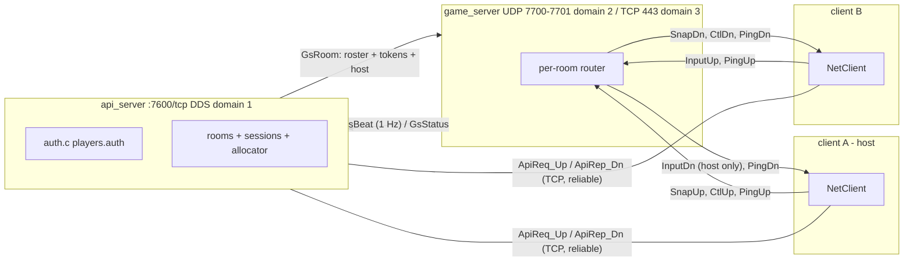
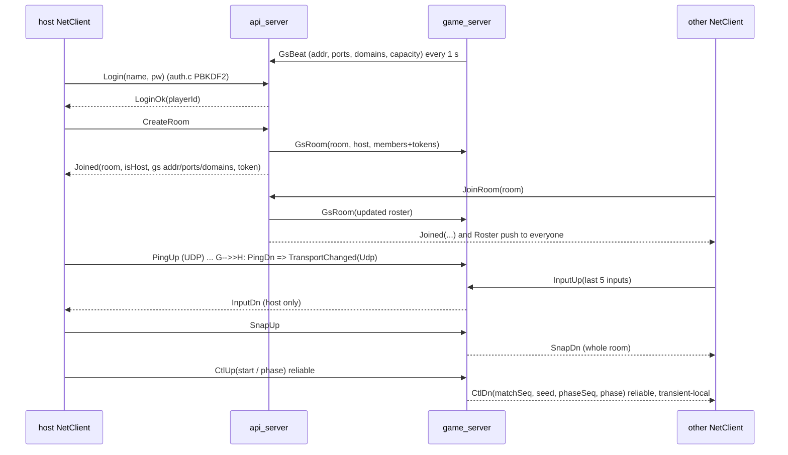
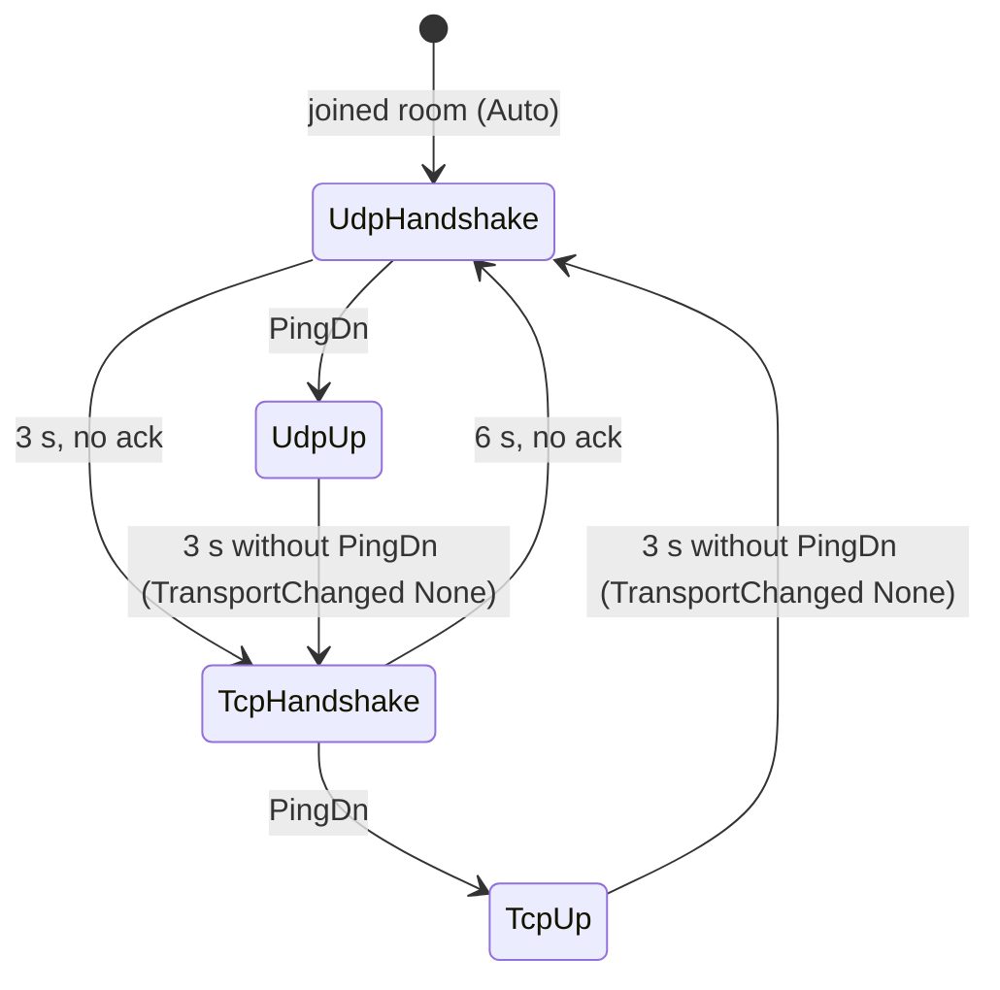
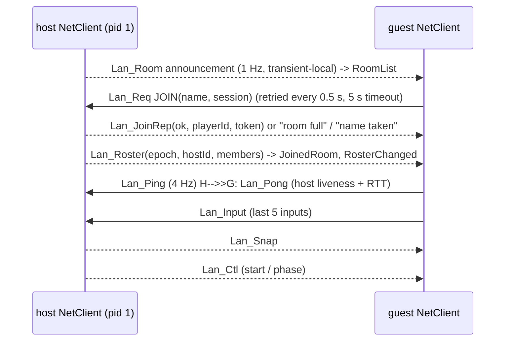

# Drifto multiplayer: API service, game service, NetClient

This is the networking design of the C++ game (`drifto`). The legacy C
`server`/`client` (domain 0, `messages.idl`) are untouched and still described
in [NETWORKING.md](NETWORKING.md).

* **API service** (`./api_server`) -- CycloneDDS over **TCP**. Login (auth.c,
  `players.auth`), room list/create/join/leave, ready flags, host election,
  and the **room allocator**: game servers register with it and every new
  room is assigned to one of them.
* **Game service** (`./game_server`) -- CycloneDDS over **UDP**, plus the same
  service over **TCP port 443** for networks that block UDP. It is a pure
  **router**: it forwards each room's packets between that room's clients and
  runs **no simulation at all**.
* **Rooms hold at most 4 players** (`net::kMaxRoomPlayers`, a 4-player
  elimination race with nitro). The API server refuses a 5th join with
  `JoinFailed("room full")`, room lists report `maxPlayers = 4`, and a game
  server never accepts more than 4 members of a room even if told otherwise.
* **Host authority** -- one client per room (the host) simulates every car
  from everyone's inputs and publishes snapshots. Non-hosts predict their own
  car and reconcile against those snapshots (game/, not net/).
* **NetClient** (`net/include/net_client.h`) -- the only thing game code
  touches. Own worker thread, all calls thread-safe and non-blocking; results
  arrive as `Event`s from `pollEvents()`.

There is also a serverless **LAN mode** (`Config::mode = Mode::Lan`, section
10): same API and Events, no api_server/game_server, the host client does
their job.

Code: `net/idl/drifto_net.idl` (wire format), `net/src/net_client.cpp`
(NetClient + Online backend), `net/src/net_lan.cpp` (LAN backend),
`net/src/net_client_core.h` (state shared by both backends),
`net/src/net_common.{h,cpp}` (shared DDS helpers), `net/config/*.xml` (DDS
config templates), `server_folder/src/{api_server,game_server,server}.cpp`,
`net/tests/net_tests.cpp`, `net/net.mk`.

---

## 1. Architecture



Clients only ever talk to the two servers. Discovery is unicast-only
(`AllowMulticast=false`, `Peers` = the server) and DDS does not relay
discovery, so clients never discover each other -- even on a LAN all game
traffic goes through the game server, and it works across NAT where clients
can reach only the server.

### Typical flow



---

## 2. Ports, domains, processes

| What | Default | Override | Notes |
|---|---|---|---|
| API service | TCP **7600**, DDS domain 1 | `api_server --port N`, env `DRIFTO_API_PORT`; client `Config::apiPort` / `apiHost="host:port"` | clients and game servers dial it |
| Game service, UDP | UDP **7700 + 7701**, domain 2 | `--udp-port N` (uses N and N+1, `0` = off), `--udp-domain`, env `DRIFTO_GAME_UDP_PORT` | N = discovery, N+1 = data (participant index 0, `Ports/Base = N-10-250*domain`) |
| Game service, TCP fallback | TCP **443**, domain 3 | `--tcp-port N` (`0` = off), `--tcp-domain`, env `DRIFTO_GAME_TCP_PORT` | 443 so it passes firewalls that only allow HTTPS |

The game server tells the API server its address, ports and domain ids; the
API server hands them to clients in the `Joined` reply, so clients need only
the API server's address. Several game servers can register with one API
server (give each its own `--id`, ports and, if on one machine, domain ids).

**Port 443 needs privileges.** Binding ports < 1024 needs root or the
capability, once per build of the binary:

```sh
sudo setcap cap_net_bind_service=+ep ./game_server   # re-run after every rebuild
getcap ./game_server
```

or run on a high port (`--tcp-port 8443`, `DRIFTO_GAME_TCP_PORT=8443`) and
redirect 443 to it with the firewall
(`sudo iptables -t nat -A PREROUTING -p tcp --dport 443 -j REDIRECT --to-port 8443`).
The tests use 17443 for exactly this reason.

---

## 3. Topics, partitions and QoS

All types are in `net/idl/drifto_net.idl` (compiled by `idlc -x final` into
`build/net/gen/`). `*_Up` = written by clients, read by servers; `*_Dn` =
written by servers, read by clients. Clients never create a reader on an Up
topic -- and DDS Security's `permissions.xml` forbids it (verified by the
tests: "Not Allowed By Security").

| Topic | Writer -> reader | Partition | QoS | Key |
|---|---|---|---|---|
| `Drifto_ApiReq_Up` | client -> api | default | RELIABLE, KEEP_LAST 64 (server reader 4096), volatile; client sends only once matched | - |
| `Drifto_ApiRep_Dn` | api -> one client | `s<session hex>` | RELIABLE, KEEP_LAST 32, **TRANSIENT_LOCAL** (no race with partition matching); `repSeq` dedups re-delivery | - |
| `Drifto_GsBeat` | game srv -> api | default | RELIABLE, KEEP_LAST 1, 1 Hz | gsId |
| `Drifto_GsRoom` | api -> one game srv | `gs.<gsId>` | RELIABLE, KEEP_LAST 1, TRANSIENT_LOCAL | roomId |
| `Drifto_GsStatus` | game srv -> api | default | RELIABLE (room phase -> `inProgress`) | roomId |
| `Drifto_Input_Up` | client -> game srv | default | **BEST_EFFORT**, KEEP_LAST 1 (server: 16 per player); each packet carries the **last 5 inputs** | playerId |
| `Drifto_Input_Dn` | game srv -> **host only** | `r<room>.p<hostId>` | BEST_EFFORT, KEEP_LAST 8 / reader 32 | playerId |
| `Drifto_Snap_Up` | host -> game srv | default | BEST_EFFORT, KEEP_LAST 1 | roomId |
| `Drifto_Snap_Dn` | game srv -> room | `r<room>` | BEST_EFFORT, KEEP_LAST 1 / reader 2 | roomId |
| `Drifto_Ctl_Up` | host -> game srv | default | **RELIABLE**, KEEP_LAST 32; queued until the link is up and matched | playerId |
| `Drifto_Ctl_Dn` | game srv -> room | `r<room>` | **RELIABLE, TRANSIENT_LOCAL**, KEEP_LAST 1: full match state, so late joiners / transport switchers get it | roomId |
| `Drifto_Ping_Up` | client -> game srv | default | BEST_EFFORT; 5 Hz handshake, 4 Hz heartbeat | playerId |
| `Drifto_Ping_Dn` | game srv -> sender | `r<room>.p<pid>` | BEST_EFFORT; also gives `rttMs()` | playerId |

Partitions do the per-room filtering at the *writer* (DDS only sends to
matched readers), so a client receives only its room's traffic, and only the
host receives inputs. Roster / host changes go over the API service (reliable
`Roster` push on `ApiRep_Dn`).

**Validation.** On join the API server gives each (room, player) a random
64-bit token and sends the roster + tokens to the room's game server.
Every Up packet carries (roomId, playerId, token); the game server drops
packets with an unknown room/player/token, and Snap/Ctl packets from anyone
but the current host ("rejected" counter in its 10 s stats line).

**Match control.** `startMatch`/`setPhase` -> `CtlUp`; the game server keeps
the room's state `{matchSeq, trackSeed, startTick, phaseSeq, phase}`, bumps
the seqs and republishes the whole state. NetClient emits `MatchStarted` when
`matchSeq` grows and `PhaseChanged` when `phaseSeq` grows, so nothing fires
twice and a late joiner gets `MatchStarted` + the current phase. Every client
(including the host) gets these events from the server.

**Sizes / encoding.** `CarW` = 56 B on the wire, vs 84 B `CarState` in memory:

| CarState field | wire |
|---|---|
| playerId, lastInputTick, trackSection | int32 / uint32 |
| position | float x3 |
| rotation | unit quaternion, 4 x int16 (* 32767, w >= 0) |
| velocity / angularVelocity | int16 x3 @ 1 cm/s / 1 mrad/s (+-327 m/s, +-32 rad/s) |
| driftScore, distance | float |
| flags | octet = `net::CarFlag` bits (alive, drifting, crashed, nitro, slipstream, eliminated) |
| nitro gauge 0..1 | octet (* 255, error <= 0.002) |
| place, eliminatedOrder | octet each |

Per snapshot (header): hostTick, hostTimeUs, phase, phaseTimer,
`eliminationTimer` (float), `eliminationStage` (octet), `lastPlacePlayerId`,
`winnerPlayerId` (int32). A 4-car snapshot is ~270 B payload (~8 KB/s per
client at 30 Hz). Inputs are 8 B each: tick, steer int8 (* 127),
throttle/brake uint8 (* 255), flags octet (bit0 handbrake, **bit1 nitro**);
an input packet carries the last 5, ~64 B. All of it is round-trip checked by
`net_tests`.

**Inputs.** `sendInput()` on the host goes straight into its own
`takeInputs()` queue (never leaves the process). Others send a packet per call
carrying the last 5 inputs; the host's NetClient de-duplicates by
(playerId, tick) and treats a tick more than 120 below the last one as a
counter restart (new match). `MatchStarted` also resets de-dup.

---

## 4. Transport selection and the TCP-443 fallback

`NetClient::Config::transport`:

* `Auto` (default): try UDP; if the game server hasn't answered a ping within
  **3 s**, delete the UDP participant and switch to TCP (budget 6 s, then
  back to UDP, and so on). Once up, if no ping answer arrives for **3 s**
  (pings every 250 ms) the link is declared lost: `TransportChanged(None)`,
  then the other transport is tried (UDP -> TCP; TCP -> UDP -> TCP ...).
* `UdpOnly` / `Tcp443Only`: only that transport, retried forever.

Every time a link gets its first ping answer NetClient emits
`TransportChanged(Udp|Tcp443)`; `transport()` returns the current one
(`None` while handshaking). If the game server advertises UDP port 0, Auto
goes straight to TCP.



Measured locally: blocked UDP -> on TCP **3.7 s** after joining; UDP cut
mid-session -> loss detected after **3.0 s**, back on TCP after **3.7 s**.

Why the fallback matters beyond firewalls: CycloneDDS over UDP sends to the
addresses a peer *advertises*. A client behind consumer NAT advertises its
private address, so the server's replies never arrive (Cyclone 0.10 has no
UDP NAT traversal). That is detected exactly like a blocked UDP port and Auto
ends up on TCP, which works through NAT because the server answers over the
connection the client opened (`AlwaysUsePeeraddrForUnicast`). UDP is used
when the client is reachable: same LAN, VPN (Tailscale/WireGuard), public IP.

---

## 5. Host election, migration, timeouts

* The room creator is host. Join order is kept; if the host leaves (or its
  session times out), the **next player in join order** becomes host.
* The API server pushes a `Roster` to everyone; NetClient emits
  `RosterChanged` and, when the host id changed, `HostChanged` with
  `isHost` = whether *we* are now host. The game server gets the new host
  through `GsRoom` and immediately routes inputs to it and accepts its
  snapshots/match control.
* Timeouts: a logged-in client heartbeats the API every 1 s; silent for
  **6 s** -> logged out and removed from its room (tested: a SIGKILLed host
  is replaced 5.3 s later). A game server silent for 5 s -> its rooms are
  closed (`LeftRoom` "room closed: game server lost"). If the API server
  disappears, NetClient emits `Disconnected` after 6 s without replies;
  if the server forgot the session (restart) it emits `Disconnected("session
  expired")` and the game must log in again.
* Empty rooms are closed. Rooms on a game server whose API server vanished
  are garbage-collected after 120 s without traffic.

---

## 6. Security

**DDS Security works with this install** (Debian `libddsc0debian` ships
`libdds_security_{auth,ac,crypto}.so` in `/usr/lib/x86_64-linux-gnu/libddsc0debian/`
and libddsc finds them there). All three processes use the existing PKI from
`gen_certs.sh` (`certs/server.*` for both servers, `certs/client<N>.*` for
clients via `Config::certIndex`). `governance.xml` / `permissions.xml` got
*additional* rules for domains 1-30 (the legacy domain-0 rules are untouched;
`make certs` re-signs them):

* governance: discovery + liveliness encrypted, `Drifto_Api*` / `Drifto_Gs*`
  payloads **encrypted** (passwords, tokens), gameplay topics **signed**
  (integrity) but not encrypted to keep per-packet cost low.
* permissions: clients may publish only `Drifto_*_Up` and subscribe only
  `Drifto_*_Dn`; the server identity gets the opposite plus `Drifto_Gs*`.

Plain DDS is an explicit choice, never a silent fallback: `api_server
--insecure`, `game_server --insecure`, `Config::insecure = true` or env
`DRIFTO_INSECURE=1`. Secure and insecure participants cannot talk to each
other, so all three must agree. If security is on and something is missing,
start fails with a message naming the file / telling you to run
`make certs`.

Threat model: every client install carries the same client keys (as in the
legacy project), so DDS Security proves "a genuine Drifto install", not who
the player is -- that is what the auth.c login and the per-room tokens are
for. A modified client could still subscribe to other sessions' reply
partitions and learn tokens; fixing that needs per-player certificates.

---

## 7. Running it

```sh
make certs api_server game_server drifto        # (make all builds legacy too)

./api_server                                    # TCP 7600, players.auth
./game_server --tcp-port 8443                   # UDP 7700/7701 + TCP 8443, registers with 127.0.0.1:7600
# or, with the capability set:  ./game_server   # TCP 443
./drifto ...                                    # NetClient::Config.apiHost = the API server
```

All three expect to be run from the repo root (`certs/`, `net/config/`,
`players.auth`); otherwise pass `--certs DIR --config DIR --auth FILE`
(NetClient: `Config::certDir`, `Config::configDir`). The XML templates have
built-in copies, so a missing `net/config` is not fatal.

### Remote deployment (internet)

On a VPS / any box with a public IP (the API and game server can share it):

```sh
git clone ... && cd csd3116_project && make certs api_server game_server
./api_server --port 7600
sudo setcap cap_net_bind_service=+ep ./game_server
./game_server --api 127.0.0.1:7600 --public-addr my.server.example --tcp-port 443
```

* Open the firewall / security group: **TCP 7600**, **UDP 7700-7701**, **TCP 443**.
* `--public-addr` is what clients are told to dial *and* (resolved to an IP)
  what Cyclone advertises as `ExternalNetworkAddress` -- required when the
  machine is behind 1:1 NAT (AWS/GCP/home router), otherwise Cyclone
  advertises the private address and remote data never arrives. Use the same
  for the API server if needed: `api_server --public-addr ...`.
* Home server behind a router: forward the same ports to it.
* Copy `certs/ca.pem`, `certs/clientN.*`, `certs/governance.p7s`,
  `certs/permissions.p7s` to the players (the PKI must be the same on all
  machines) and set `apiHost` to the server's name/IP.
* Several game servers: run more `game_server --api <api host> --id gs2
  --public-addr <its addr>` anywhere; the API server picks the least loaded
  (`--capacity`, default 64 rooms).
* Keep them running with e.g. a systemd unit or `tmux`; logs go to stdout.

---

## 8. Tests and numbers

```sh
make net_tests && ./net_tests            # from the repo root; ./net_tests --insecure; --only <scenario>
make net-check                           # same
```

`net_tests` starts two local deployments -- A: api :17600 + gsA (UDP
17700/17701, TCP 17443) and B: api :17601 + gsB (TCP 17444, UDP advertised
but not served, `--simulate-udp-blocked`) -- and runs each scenario in its
own process with real NetClients as headless players: login (ok / bad
password / duplicate / invalid), rooms + roster + ready flags, inputs to the
host (incl. host short-circuit, de-dup, content incl. the nitro bit),
snapshots to non-hosts (every field checked after quantization, incl. nitro
gauge, place, eliminatedOrder, CarFlag bits and the elimination header),
reliable start/phase incl. late joiner, non-host start ignored, the 4-player
cap (5th join -> "room full", RoomList 4/4), host leave -> HostChanged, `Tcp443Only`, mixed TCP/UDP room,
Auto fallback, mid-session UDP loss (SIGUSR1 to the game server drops its UDP
traffic), crash timeout -> promotion, and DDS Security ACLs. Logs:
`build/net/test_run/`.

Snapshot path host -> game_server -> client, same machine (WSL2), DDS
Security on, measured by the tests (one-way, same clock):

| Path | Rate / size | Received | Latency avg / p50 / p99 |
|---|---|---|---|
| UDP | 30 Hz, 3 cars | 100 % | 0.42 / 0.41 / 0.72 ms |
| UDP | 60 Hz, 4 cars | 100 % | 0.40 / 0.40 / 0.70 ms |
| UDP | 1000 Hz, 4 cars (~0.27 MB/s, stress) | 100 % | 0.26 / 0.26 / 0.42 ms |
| TCP | 30 Hz, 3 cars | 100 % | 0.47 / 0.45 / 0.76 ms |
| TCP | 60 Hz, 4 cars | 100 % | 0.37 / 0.39 / 0.56 ms |
| TCP | 1000 Hz, 4 cars (stress) | 100 % | 0.26 / 0.25 / 0.43 ms |

Ping RTT ~0.2-0.5 ms. Login incl. DDS discovery + security handshake ~0.5 s;
joining a room until the game link is up ~0.8 s.

---

## 9. CycloneDDS 0.10.4 findings (what works, what doesn't)

* **Works:** `dds_create_domain(id, xml)` with a different config per domain
  in one process (the game server runs UDP + TCP + API-client domains at
  once); `General/Transport` `tcp` with `Discovery/Peers` = `host:port`;
  `TCP/Port -1` (clients only dial out); `TCP/AlwaysUsePeeraddrForUnicast`;
  UDP unicast-only discovery with a fixed participant index and `Ports/Base`;
  `ParticipantIndex none` (ephemeral ports) for clients; partitions incl.
  `*` in permissions; DDS Security over both TCP and UDP.
* **`TCP/NoDelay` is not applied** -- no socket gets `TCP_NODELAY`, so small
  messages wait for Nagle + delayed ACK (measured 30-45 ms p99, sometimes
  33 ms median at 30 Hz). Workaround: `net::dds::tuneTcpSockets()` sets
  `TCP_NODELAY` on the process' TCP sockets every 250 ms (accepted sockets
  inherit it from the listener). Result: TCP p99 0.7 ms.
* **`dds_delete(domain)` can self-deadlock** on a TCP domain with live
  connections (seen in `api_server` shutdown: `rtps_fini ->
  remove_from_addrset`). The servers therefore exit without DDS teardown;
  NetClient deletes domains on a helper thread and stops waiting after 3 s.
* **`<Tracing>` aborts** with a fortify "buffer overflow" while dumping the
  config in this Debian build -- don't enable Cyclone tracing.
* Creating a **second secure participant in a domain while another one in
  the same process is mid-handshake** sometimes fails
  (`get_identity_token: Invalid handle`). Only multi-client test processes
  hit it; `createParticipant()` retries.
* **No UDP NAT traversal** (see section 4) -- the TCP path covers it.
* **Deleting a UDP domain with multicast enabled hangs when multicast
  doesn't work** (WSL2 NAT): the multicast receive thread is never woken,
  `dds_delete(domain)` blocks joining it, and it holds Cyclone's global lock
  so every later DDS call blocks too. LAN mode therefore keeps its domain
  for the life of the process (`acquireDomain(..., persistent=true)`).
* Unicast discovery is symmetric: if either side lists the other in
  `<Peers>` (with `ParticipantIndex auto`), both discover each other.
* SSL/TLS over TCP (`<SSL>`) exists in the config schema but wasn't needed:
  DDS Security already encrypts what matters.

## 10. LAN mode (no servers)

`NetClient::Config::mode = NetClient::Mode::Lan` (drifto: `--lan`, plus
`--lan-peer IP` as often as needed). No api_server, no game_server, no port
forwarding. The public API and every Event behave as in Online mode; the
differences a player can notice:

* `login(name, password)` succeeds locally (same name rule as Online: 1-8
  letters/digits/`_`/`-`); the password is ignored. `LoginOk.localPlayerId`
  is 0 -- LAN player ids are per room (`JoinedRoom.localPlayerId`).
* `requestRoomList()` lists rooms whose host announced them within the last
  3 s. Discovery takes ~0.3-1 s after `start()`, so a lobby screen should
  refresh the list periodically.
* `rttMs()` on a guest is the round trip to the host; on the host it is 0.
* `transport()` is `Udp` while in a room (`TransportChanged(Udp)` on join).

### How it works



All LAN traffic is in **DDS domain 10**, UDP. Discovery uses Cyclone's
default **multicast** (239.255.0.1, port 9900) plus `lanPeers` as unicast
`<Peers>`; participant index `auto` gives each process well-known unicast
ports (9910+2i discovery, 9911+2i data, i = 0..20), so a peer given only by
IP is found. Only one side needs to know the other: a joiner with
`--lan-peer <host IP>` finds a host that has no peers configured.
Firewall: allow UDP 9900-9952 in and out.

| Topic | Writer -> reader | Partition | QoS | Key |
|---|---|---|---|---|
| `Drifto_Lan_Room` | host -> everyone | `lan` | RELIABLE, TRANSIENT_LOCAL, KEEP_LAST 1, rewritten every 1 s; `closed=true` + unregister when the last player leaves | roomKey (random 64-bit; low 32 bits = roomId) |
| `Drifto_Lan_Req` | member -> host: join / ready / leave | `lan.r<room>` | RELIABLE, KEEP_LAST 32 (join is retried) | session |
| `Drifto_Lan_JoinRep` | host -> one joiner | `lan.r<room>.s<session>` | RELIABLE, TRANSIENT_LOCAL | session |
| `Drifto_Lan_Roster` | host -> room | `lan.r<room>` | RELIABLE, TRANSIENT_LOCAL, KEEP_LAST 1 | roomId |
| `Drifto_Lan_Ctl` | host -> room (match state + seqs, like `Ctl_Dn`) | `lan.r<room>` | RELIABLE, TRANSIENT_LOCAL, KEEP_LAST 1 | roomId |
| `Drifto_Lan_Input` (InputUp) | guest -> host; **only the host creates a reader** | `lan.r<room>` | BEST_EFFORT, last 5 inputs per packet | playerId |
| `Drifto_Lan_Snap` (SnapUp) | host -> room | `lan.r<room>` | BEST_EFFORT, KEEP_LAST 1 / reader 2 | roomId |
| `Drifto_Lan_Ping` / `_Pong` | guest <-> host | `lan.r<room>` | BEST_EFFORT, 4 Hz | playerId |

The host admits up to 4 players with unique (case-insensitive) names,
assigns player ids 1, 2, 3 ... and a random token per player; the roster
carries SHA-256(token) so whoever becomes host can validate everyone's
inputs/pings, and snapshots are only accepted from the current host with a
valid token. Same quantization, redundancy and de-dup as Online (section 3).

### Host loss and migration

* A guest that hears nothing from the host (pong, snapshot, roster, match
  control) for **3 s** drops it and promotes the **lowest remaining player
  id**; every guest computes the same answer. The new host bumps the roster
  `epoch`, publishes the roster, re-announces the room under the **same
  roomId**, re-publishes the current match state (so late joiners still get
  `MatchStarted` + the phase) and starts consuming inputs. Everyone gets
  `RosterChanged` + `HostChanged` exactly as in Online. Rosters with an
  older epoch (a deposed host coming back) are ignored, and such a host
  leaves the room when it sees itself missing from the newer roster.
* A host that calls `leaveRoom()`/`stop()` hands over at once (roster with
  the next host, no 3 s wait); if it was alone the room is closed and leaves
  every list immediately.
* The host drops guests that haven't pinged for 4 s.
* Rooms whose host died fall out of `RoomList` after 3 s (measured 2.9 s).

Measured on this machine: host killed -> new host 3.0 s later; dead room
gone from lists after 2.9 s; snapshot latency 0.17 ms p50 (same machine).

### Security

With DDS Security on (default), LAN players need the same `certs/` as
Online (`ca.pem`, `client<N>.pem/.key`, `governance.p7s`,
`permissions.p7s`); `permissions.xml` grants every client identity
publish + subscribe on `Drifto_Lan_*` in domain 10 (re-sign with `make
certs` and redistribute `permissions.p7s`). LAN players without certs use
`--insecure` / `Config::insecure` / `DRIFTO_INSECURE=1` -- and then **all**
players in that LAN game must be insecure (secure and insecure participants
ignore each other). Missing cert files make `start()` fail with a message,
never a silent downgrade.

### Network caveats

* **WSL2**: the default NAT networking gives WSL its own virtual network;
  LAN multicast doesn't reach it, and here not even multicast loopback
  works (net_tests probes it and skips the pure-multicast scenario). To
  play LAN from WSL2 use mirrored networking: in `%UserProfile%\.wslconfig`
  ```ini
  [wsl2]
  networkingMode=mirrored
  ```
  then `wsl --shutdown`, and allow the traffic through Windows Defender
  Firewall (Hyper-V firewall), e.g. in an admin PowerShell:
  `New-NetFirewallHyperVRule -Name DriftoLAN -DisplayName "Drifto LAN" -Direction Inbound -VMCreatorId '{40E0AC32-46A5-438A-A0B2-2B479E8F2E90}' -Protocol UDP -LocalPorts 9900-9952 -Action Allow`
  (or `Set-NetFirewallHyperVVMSetting -Name '{40E0AC32-46A5-438A-A0B2-2B479E8F2E90}' -DefaultInboundAction Allow`).
  In NAT mode `--lan-peer` alone is not enough either: Windows' Hyper-V
  firewall drops traffic coming *into* the WSL VM (checked: UDP and TCP from
  Windows to the WSL IP time out). Mirrored mode is the fix.
* **School / public Wi-Fi** usually has **client isolation** (devices can't
  talk to each other at all) and often filters multicast. LAN mode cannot
  work there -- not even with `--lan-peer`. Use Online mode, a phone hotspot,
  or a VPN overlay (Tailscale/ZeroTier: give the peers' VPN IPs with
  `--lan-peer`).
* **Multicast blocked but devices can reach each other** (many home/office
  routers, some switches, Wi-Fi with IGMP snooping misconfigured): pass
  `--lan-peer <host IP>` on the joining machines (or on the host listing the
  guests). `DRIFTO_LAN_MULTICAST=0` turns multicast off entirely (used by the
  tests to prove the unicast path).

### LAN tests

`./net_tests --lan-only` (no servers started; also part of the full run):

* `lan_room` (one process, 6 clients): local login + invalid name, create,
  discovery, join, ids 1-4, host flags, "name taken", "room full" for the 5th,
  "host gone" for an unknown room, ready flag, RTT, inputs -> host (+ content,
  de-dup), snapshots -> guests (content), start/phase, non-host start
  ignored, inProgress, graceful host leave -> id 2 promoted, room
  re-announced, inputs/snapshots via the new host, late joiner gets the
  running match.
* `lan_crash` (host in another process, SIGKILLed): lowest id promoted, roster
  shrinks, room re-announced with the same id, traffic continues.
* `lan_dead_room`: killed host's room leaves the list (~2.9 s); a host leaving
  alone closes it at once.
* `lan_unicast`: multicast off everywhere; control (no peers anywhere -> not
  found) and joiner-only `lanPeers` -> found, joined, snapshots.
* `lan_multicast`: pure multicast across processes; skipped automatically
  where multicast loopback doesn't work (this WSL2 box).

## 11. Windows client notes

`drifto.exe` is built with MSVC and vcpkg (see README "Windows native client").
On Windows it uses CycloneDDS **0.10.5** from vcpkg, built with the `security`,
`ssl` and `idlc` features. It is the same 0.10 series as the Linux servers'
0.10.4, and was checked against them: secure login, room, and game link with the
UDP -> TCP fallback, all from Windows. The DDS Security plugins
(`dds_security_{auth,ac,crypto}.dll`) and OpenSSL 3 DLLs are copied next to
the exe.

* **TCP_NODELAY**: Windows has no `/proc/self/fd`, so `tuneTcpSockets()`
  probes the low socket-handle range (multiples of 4 below 0x4000) once a
  second.
* **Interface choice**: Windows PCs often have VPN or virtual adapters, and
  CycloneDDS left alone picks one of them (seen: Radmin VPN on one PC, a
  disconnected Tailscale adapter on another), which breaks LAN play. LAN mode
  therefore pins the adapter that carries the default route (the one facing
  the router) and logs `[net] LAN: using interface <IP> ...`. Set
  `DRIFTO_DDS_INTERFACE=<adapter name or IPv4>[,...]` to override it (e.g.
  when a full-tunnel VPN owns the default route); it works on every platform
  and for every client domain.
* **LAN**: native Windows multicast works. Two `lan_probe.exe` processes with
  DDS Security on found each other and joined in 0.6 s, with an RTT of
  0.5 ms. Windows <-> WSL2 (NAT mode) on the same PC does not work: the
  Hyper-V firewall blocks traffic into the VM.
* **Teardown**: when a TCP peer is unreachable, Cyclone's event thread sits
  in a blocking `connect()` (about 20 s on Windows, about 2 min on Linux), and
  `dds_delete(participant)` waits for it. NetClient therefore deletes
  participants on a helper thread with a time limit
  (`dds::deleteEntityBounded`). It also keeps client domains alive for the
  whole process, reusing them while the config is unchanged. Quitting with an
  unreachable `--api` now takes 1 s instead of hanging.
* Untested here: cross-OS LAN with security. One attempt logged
  "Remote secure participant not allowed" on Windows before the firewall cut
  the handshake. Try it on two real machines; if it fails, use `--insecure` on
  every player in that LAN game.

## 12. Not done / ideas

* Per-player certificates (see threat model); rate limiting of logins.
* Reconnecting to the same room after the API session expired (the game must
  log in and join again).
* A `Ctl` request sent just before a transport switch can be lost (it is
  only queued until the *current* link is up); the host can simply resend.
* LAN: a guest that crashes is dropped by the host after 4 s, but that
  path has no dedicated test; split-brain after a real network partition is
  resolved by epoch (higher wins) but only lightly exercised.
* Delta compression of snapshots (not needed at 4 players: ~8 KB/s per
  client at 30 Hz).
